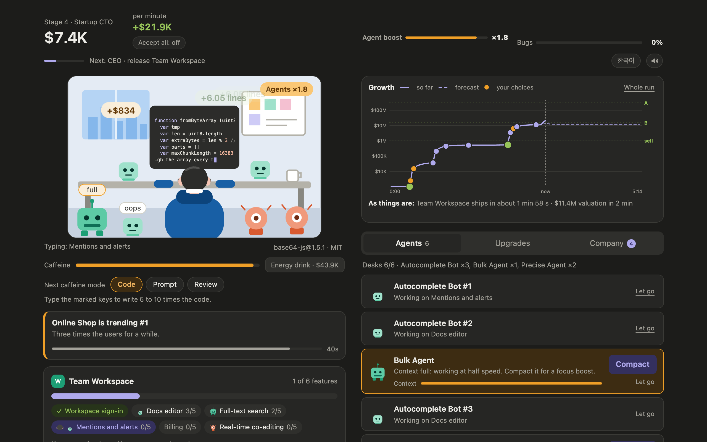
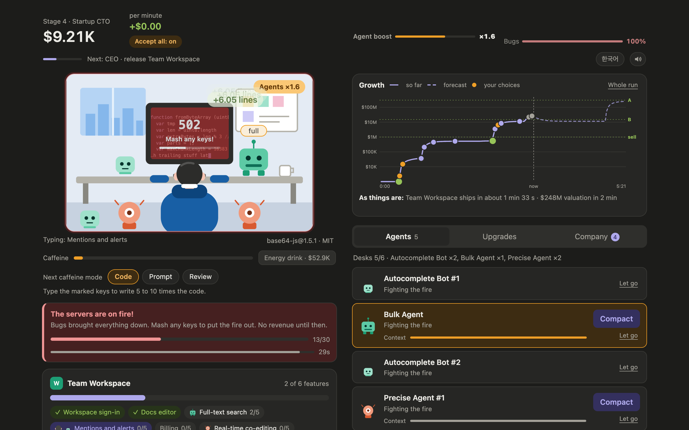
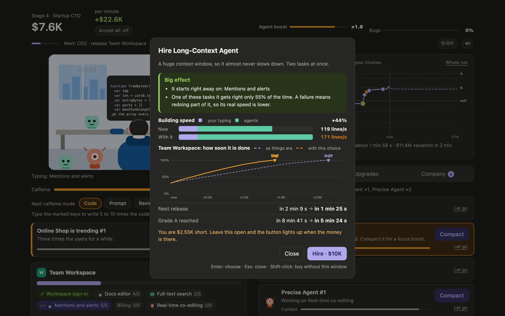
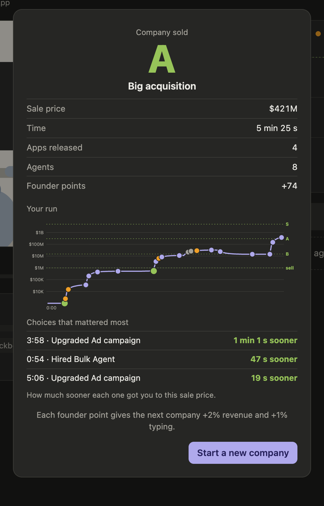
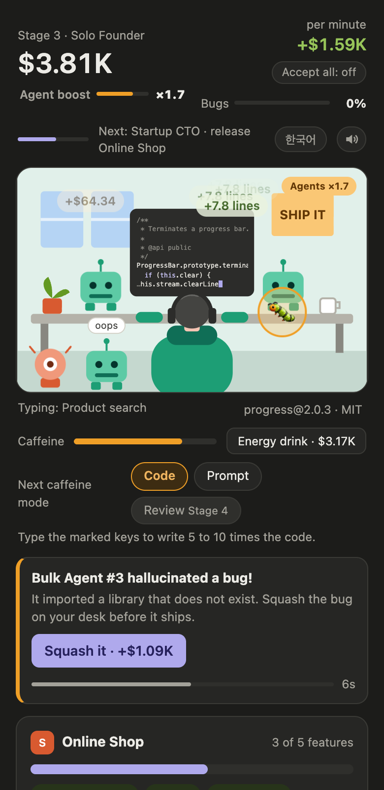

# Dev Idle

A typing idle game. You start as one developer writing a to-do app by hand, hire AI coding agents with what it earns, ship four bigger apps, and sell the company for a grade. A run takes about eight to ten minutes.

I made it for the game assignment of a startup course at KAIST. It runs in the browser with no build step and no server, and it plays in English or Korean.



## How to play

Open `index.html`. That is all it needs.

Any key writes code. You are not typing real text: every key press puts the next few characters of an open-source file on the monitor and adds lines to the feature you are building. On a phone, tap the desk instead. The first game walks you through the start with a short tutorial, which you can skip.

A run goes like this.

1. Type until the three features of the to-do app are done (about 120 keys), then press Release. The launch pays enough for your first agent.
2. Agents write code on their own. Keep typing anyway: your typing heats them up, and at full heat they work twice as fast. Stop and they cool down in a few seconds.
3. Each release takes you up a stage and opens the next app: Photo Share, Online Shop, Team Workspace, AI Service. Each is worth about ten times the one before, and takes longer to build.
4. From stage 3, once the company is valued at $1M, you can sell it. The grade follows the price: C, then B from $15M, A from $300M, S from $5B. Sell early for a quick C, or hold on for more.

Selling ends the run. You keep founder points (each one gives the next company +2% revenue and +1% typing) and your achievements, and start over from the to-do app.

## What gets in the way

**Accept All.** A switch that opens at stage 3. Off, an agent that fails a task redoes a quarter of it. On, agents work 1.3 times as fast and a failed task ships anyway, but every failure fills the bug gauge. It drains slowly while the switch is off.

**Fires.** When the bug gauge is full, the servers go down: no revenue and no agent work. Mash any keys to put the fire out. The first fire takes 30 keys, each later one 10 more, up to 80. Left alone it burns out in 30 seconds.

**Context.** Bulk and Precise agents fill their context as they work. A full agent drops to half speed. Click its robot to play a three-round timing game; that empties the context and gives the agent a focus boost of 1.3 to 2.5 times for 40 seconds, depending on how well you timed it.

**Hallucinated bugs.** Now and then an agent imports a library that does not exist, and a bug crawls across your desk. Click it within 10 seconds for a little cash. Miss it and it goes into the bug gauge.



**Caffeine mode.** 250 key presses fill a gauge and start 20 seconds in which the monitor marks the exact key to press next. Right keys write five times the code, more as the streak grows. Later you can pick two other kinds of round: one where you type a prompt to make every agent more accurate for two minutes, and one where you find the buggy line in an agent's diff.

There are also a few events that are plainly good news: an app trending for 45 seconds, an investor offering cash for 5% of your revenue, a maintainer asking for a quick patch.

## Seeing what a choice would do

Early versions listed agents and upgrades with a line of description each, and I could not tell which one to buy. So the price button no longer buys. It opens a window first.



The window gives a verdict (big effect, some effect, little effect, or sets you back) with the reasons right under it, in sentences like "Your agents write 83% of the code right now, so faster typing changes little." Below that are two bars for building speed, split into your typing and your agents, and a chart of how the current app fills up with and without the choice. The numbers at the bottom are the time to the next release and to the next goal.

Enter buys, Escape closes. Shift-click a price to skip the window.

The forecast comes from playing a copy of the game forward ten minutes with the dice removed: an agent's failures become a slower expected speed, no random events happen, and apps are released the moment they are ready. Both lines start from the same copy, so the difference between them is the choice and nothing else. It assumes you keep typing at your recent pace. Real runs have luck in them, so read it as a guide.

## The growth chart

The chart on the right is the company's valuation over the run, on a log scale, with the sell line and the grade lines drawn across it. The solid line is what happened; the dashed line is the forecast for the next two minutes.

Every hire, upgrade, release and fire leaves a dot. Hover over the dot of a hire or an upgrade, or click it, and a grey line shows the run without that choice, with every later choice replayed as you made it. The caption says where you would be now.

When you sell, the result card shows the whole run and the three choices that got you to that price soonest.

<p>
  
  &nbsp;
  
</p>

In a window under 980 px wide the two columns stack into one, as on the right above.

## Options in the address

| Add to the address | What it does |
| --- | --- |
| `?lang=ko` | Korean. The button at the top right also switches, and remembers. |
| `?touch=1` | The touch controls on a desktop. |
| `?seed=42` | The same new game every time. A seeded game is never saved. |
| `?demo=1` | A panel at the bottom to jump stages, add money, start a fire or an event, and run at up to 50 times speed. Saved apart from a normal game. |

## Saving

The game saves to the browser's `localStorage` every ten seconds. Nothing leaves your machine. A save belongs to one browser and one address, so a game played from a local file does not show up on a hosted copy.

Close the tab and come back: your agents kept working at half speed, for up to eight hours.

"Erase everything" at the bottom of the page wipes the save, founder points and achievements included. It lists what you are about to lose and asks first.

## Working on it

There is nothing to install. The tests and the balance simulator use only Node (18 or later).

```sh
node --test tests/*.test.js              # 94 tests of the rules
node tools/simulate.js --bot careful --kps 4    # how long a run takes
node tools/simulate.js --bot acceptall --kps 6  # the same with Accept All on
```

The simulator plays 20 runs with a bot that types at a steady rate, releases apps the moment they are ready and buys whatever it can afford. At four keys a second it reaches stage 3 in about a minute and grade S in about six. A person spends time deciding, so real runs are longer.

Where things are:

| Path | What is in it |
| --- | --- |
| `src/balance.js` | Every number in the game. |
| `src/content.js` | Apps, features, agents, achievements. |
| `src/core/` | The rules. Plain functions on a state object; nothing here touches the page, which is why the tests and the forecasts can run them. |
| `src/core/forecast.js` | The run log, forecasts and "what if". |
| `src/ui/` | Drawing: the desk scene, the panels, the chart, the tutorial, sound. |
| `src/strings.en.js`, `src/strings.ko.js` | All text. |
| `code-dump/` | The snippets you "type", and their licenses. |

## Credits

The code on the monitor is real. It comes from eight open-source packages (ms, debug, ws, progress, wrap-ansi, base64-js, basic-ftp, tar-stream), all MIT licensed. Their copyright notices are in [`code-dump/NOTICE.md`](code-dump/NOTICE.md) and behind the "Open-source notice" link in the game.

The agents are caricatures. "Codex-style" and "Claude-style" are jokes about personalities, not measurements of any product.

Sound effects are generated in the browser; there are no audio files. The art is SVG drawn in code.

I wrote this with Claude Code. The rules went through several rounds of playing and cutting: the first version had usage limits, subscriptions, copycat competitors and a freshness score, and was more work than fun.
